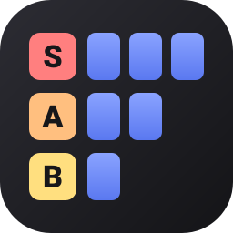

# Tier Ranker

A tiny, client-side tier list maker (think TierMaker), built as a no-build static site: plain HTML, CSS and JavaScript.

## Features

- Rank **text** or **image** items by dragging them between tiers (mouse and touch).
- **Search for images** (🔍 Search images) on Wikipedia or Wikimedia Commons and click results to add them — no API key needed.
- Add images by **file upload**, **URL**, **drag-and-drop** onto the page, or **paste** from the clipboard.
- Up to **10 rows**, each with an editable name and color, and reorder/delete controls. Defaults: `S A B C D 💩`.
- Drag an item onto the trash bin (appears while dragging) to delete it.
- Double-click a text item to edit it; click the title or a row name to rename.
- Everything is saved in the browser — nothing is uploaded anywhere. (Image search sends your search terms to the Wikimedia API.)

## Storage

- Board layout (title, rows, order, text items) → `localStorage`.
- Image data → **IndexedDB**, which stores binary blobs without base64 overhead and has a far larger quota than `localStorage`. Uploads are downscaled to 320px max and re-encoded as WebP before saving.
- Image links: the app tries to download a local copy; if the host blocks cross-origin requests, it stores the link itself instead (that item then depends on the link staying alive).
- The app asks the browser for persistent storage so data isn't evicted under storage pressure.

## Running

Live at **https://thorsteingames.com/tier-ranker** (the Thorstein Games site proxies that path to this repo's GitHub Pages site, https://thorstein-games.github.io/tier-ranker/).

Asset paths are absolute (`/tier-ranker/...`) so the app works with or without a trailing slash behind the proxy. To run it locally, serve the *parent* folder:

```sh
cd ..
python3 -m http.server 8000
# then visit http://localhost:8000/tier-ranker/
```

## Possible next steps

- Export the board as a PNG
- Export/import a board as a file to share or back up
- Multiple saved boards
